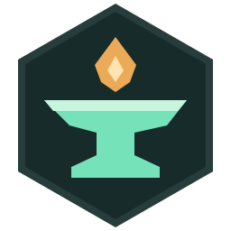

<p align="center">
  
</p>

# Krosforge

**Your profiles. Your adventures.**

Krosforge is an open-source desktop launcher that brings local accounts, client setup, and session controls into one portable application. Use your own client installation, keep your profiles on your computer, and manage multiple accounts from a single window.

[Download](https://github.com/krosforge/krosforge/releases) · [Release notes](https://github.com/krosforge/krosforge/releases/latest) · [Report an issue](https://github.com/krosforge/krosforge/issues) · [Contribute](CONTRIBUTING.md)

Check the release notes for the gameplay features and compatibility covered by each version before downloading.

## Why Krosforge?

- **Local profiles:** create separate accounts without an email address or password. Rename and manage them from the launcher.
- **Multiple accounts:** keep several profiles and select them individually or together.
- **Portable by default:** download a ZIP, extract it, and open `Krosforge.exe`. No installer, .NET installation, or database service is required.
- **Your own installation:** the launcher finds a compatible client on your computer or lets you choose its folder.
- **Your data stays with you:** profiles and settings are saved beside the executable, making the launcher easy to back up and move.

## Get started

### What you need

- A Windows x64 computer.
- Your own compatible client installation. The reference build is **3.7.14.18**.
- A writable folder for the launcher and its data, with enough free space for one complete shared client copy.

The download contains the launcher only. Game files are not included.

### Download and open

1. Open [Releases](https://github.com/krosforge/krosforge/releases) and read the notes for the version you want to use.
2. Download `Krosforge-<version>-win-x64-portable.zip` from its assets.
3. Extract the ZIP into a folder you can write to, such as a dedicated folder under Downloads or Documents.
4. Open `Krosforge.exe` from the extracted folder.

The launcher includes its dependencies and starts its local runtime automatically.

### Set up your profiles

1. Check the installation card. If no compatible client is found, use the folder selection button to choose the client installation folder.
2. Use the create-profile button and enter a name for your local account.
3. Repeat for any additional accounts, then select the profiles you want to use for a session.
4. Choose **Abrir selecionados** (Open selected). The launcher prepares one private client copy shared by all profiles and opens the game. Preparation shows progress and can be canceled. Keep the launcher open while its game windows are active.

Use a profile's **•••** menu to rename or delete it. Deletion requires typing the profile name and removes its associated records and profile data; the shared client copy is kept. Back up your data before deleting a profile you may want to keep.

## Language

The launcher supports **Français, English, Deutsch, Español, and Português**. It automatically uses your computer’s display language, including regional variants such as French Canadian or Brazilian Portuguese. If that language is not supported, it uses English.

Use the language button in the header to choose a language or return to automatic selection. The change applies immediately without closing your session or changing your selected profiles. Your preference is saved in `Krosforge-data/launcher-preferences.json` and travels with your portable data.

## Your data

After the first launch, your folder looks like this:

```text
Krosforge/
├── Krosforge.exe
└── Krosforge-data/
```

`Krosforge-data` holds your profiles, settings, local database, and the shared client copy. The native client may also create Unity caches outside this folder; these are not part of a launcher-folder backup. No `portable` marker file is needed.

**To back up or move the launcher:** close it, then copy the entire folder, including `Krosforge-data`.

Use **Configure server** in the launcher to rename your local server. All profiles share this classic, multiple-account server. Close all game windows before changing its name; it appears when you next open the game. The original installation is unchanged.

**To update:** use **Procurar atualizações** (Check for updates) in the launcher. It checks the latest stable GitHub release and asks before downloading and restarting. Close game sessions and wait for preparation to finish before installing. The update replaces the launcher executable and preserves `Krosforge-data`. New versions may migrate the local database; read the release notes for backup and downgrade instructions.

For a manual update, close the launcher, back up your folder, read the release notes for data compatibility instructions, and replace `Krosforge.exe` with the executable from the new ZIP. Keep your existing `Krosforge-data` folder.

Do not share your data folder when reporting an issue. Include the launcher version, client build, steps to reproduce, and the error message instead.

## Questions

**Do I need an online account?**

Launcher profiles are local. Creating one does not require an email address, password, or credentials from another service.

**Can I use more than one account?**

You can create multiple profiles and select them independently. The release notes describe the game-session support available in each version.

**Do I need to install a server or a database?**

No. The launcher starts its local runtime and manages its SQLite database automatically.

**Where can I check gameplay and multiplayer support?**

Read the [release notes](release-notes/0.0.2.md) for the version you are using. They document supported features, client compatibility, and limitations.

**Why are there files in the system's temporary folder?**

The .NET runtime extracts bundled native libraries to its cache automatically. The distribution still contains a single executable; your profiles stay in `Krosforge-data`.

## Contributing

Krosforge is built with C#/.NET, Avalonia, and SQLite. Bug reports, documentation improvements, and code contributions are welcome.

See [CONTRIBUTING.md](CONTRIBUTING.md) for development setup, tests, packaging, and pull request guidance.

## License and content

Original code and the application icon are licensed under [GPL-3.0-only](LICENSE). Dependencies retain their own licenses, listed in [THIRD_PARTY_NOTICES.md](THIRD_PARTY_NOTICES.md). Bundled licenses can also be exported using the launcher's licenses button.

No game client, extracted assets, or credentials are included in this repository or its distribution packages. The client installation you select is a separate local source. Krosforge is an independent project and is not affiliated with the publisher of that client.
